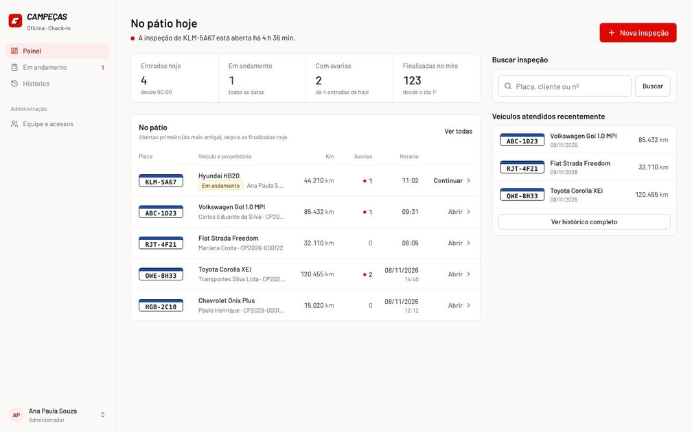
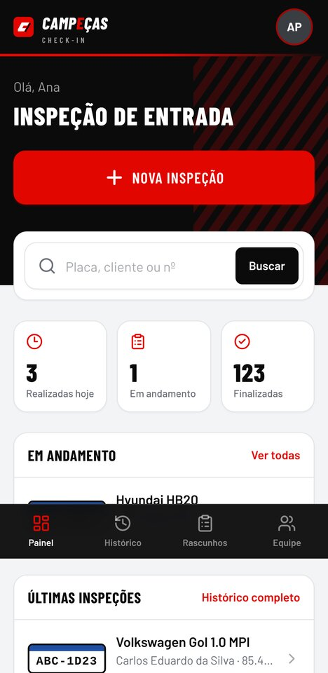
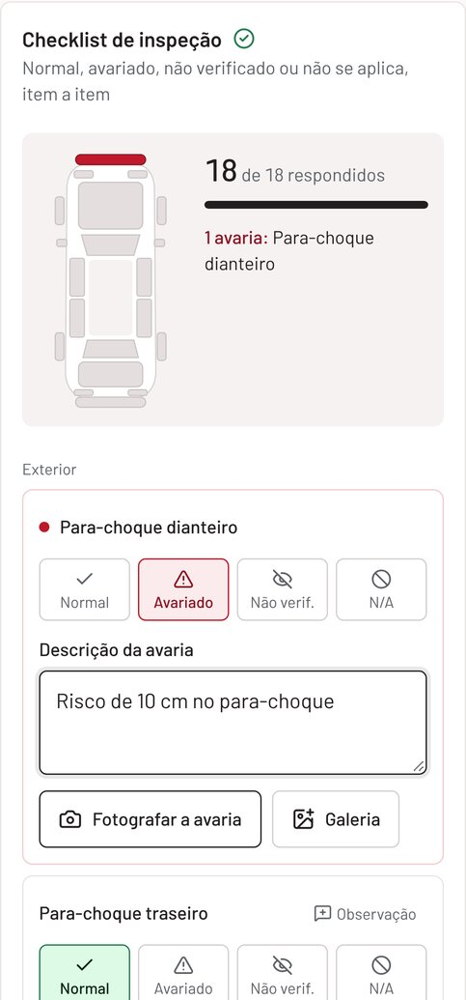
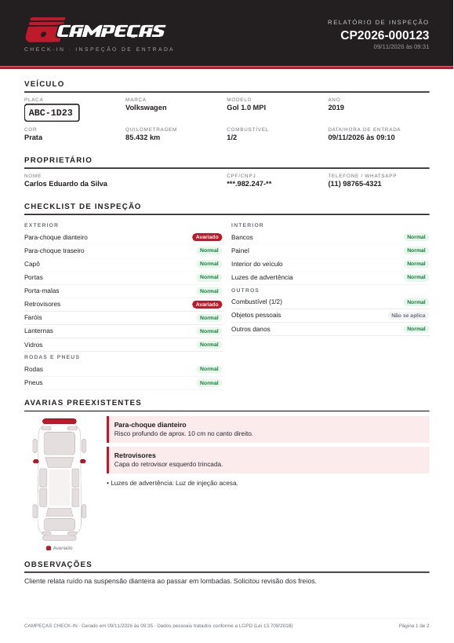

# CAMPEÇAS CHECK-IN

Sistema web da oficina **CAMPEÇAS** para a inspeção de entrada de veículos antes do início dos serviços:
dados do veículo e do proprietário, quilometragem, data e hora automáticas, checklist com 18 itens, fotografias
pela câmera do celular, avarias preexistentes, responsáveis, histórico completo e relatório PDF.

<p>
  
</p>
<p>
  
  
  
</p>

**Stack:** Next.js 16 (App Router) · TypeScript · Tailwind CSS 4 · Supabase (PostgreSQL, Auth, Storage) ·
@react-pdf/renderer · zod.

A arquitetura, o modelo de dados, as medidas de segurança e LGPD e a direção de arte estão em
[docs/ARQUITETURA.md](docs/ARQUITETURA.md).

## Funcionalidades

| Área | O que faz |
| --- | --- |
| **Painel** | Botão NOVA INSPEÇÃO, busca por placa/cliente/nº, realizadas hoje, em andamento, finalizadas, últimas inspeções, histórico de veículos |
| **Inspeção (tela única)** | Veículo (placa Mercosul/antiga, marca, modelo, ano, cor, km, data/hora automáticas) · Proprietário (nome, CPF/CNPJ, telefone, WhatsApp; busca por telefone/documento) · Checklist (Normal / Avariado / Não verificado / Não se aplica, descrição e fotos da avaria, nível de combustível) · Fotos por categoria · Finalização |
| **Agilidade** | Placa conhecida preenche veículo e proprietário; "Pendentes = Normal"; chips de mecânicos; atalho de finalização fixo no celular; aviso de km menor que a anterior |
| **Rascunho automático** | Salva no Supabase ~1 s após cada alteração e no aparelho; funciona com internet instável e recupera alterações ao reabrir |
| **Fotos** | Câmera traseira direto do navegador, compressão para JPEG, marca com placa/data/hora, armazenamento privado no Supabase Storage |
| **Finalização** | Valida pendências, gera número único (`CP2026-000124`), registra data/hora/responsável e torna a inspeção imutável |
| **Histórico** | Busca por placa, proprietário ou número, filtro por período e situação, paginação, fotos ampliáveis, histórico por veículo |
| **Mapa de avarias** | Silhueta do carro vista de cima com cada zona no estado do checklist: atualiza ao vivo no editor e aparece na inspeção finalizada e no PDF |
| **Relatório PDF** | Identidade visual Campeças, veículo, proprietário (documento mascarado), km, data, checklist, mapa e descrição das avarias, fotos, responsáveis e campos de assinatura |
| **Equipe (admin)** | Cadastrar funcionários, definir função, desativar/reativar acesso (bloqueia o login na hora), redefinir senha, anonimizar dados de clientes (LGPD) |
| **Minha conta** | Cada funcionário troca a própria senha (ex.: a provisória do primeiro acesso) |
| **Celular** | Layout mobile-first, botões grandes, instalável na tela inicial (manifest PWA) |

## Implantação

### 1. Projeto Supabase

1. Crie um projeto em [supabase.com](https://supabase.com) (região São Paulo, `sa-east-1`, recomendada).
2. Aplique as migrations deste repositório (cria tabelas, políticas RLS, gatilhos, funções e o bucket de fotos):

   ```bash
   npx supabase login
   npx supabase link --project-ref SEU_PROJECT_REF
   npx supabase db push
   ```

   Alternativa sem CLI: execute, em ordem, os arquivos de `supabase/migrations/` no **SQL Editor** do painel.
3. **Desative o cadastro público**: *Authentication → Sign In / Providers → Allow new users to sign up* = desligado.
4. **Crie o primeiro usuário** em *Authentication → Users → Add user* (marque *Auto Confirm User*).
   O primeiro usuário criado torna-se **administrador** automaticamente. Os demais funcionários são
   cadastrados pela tela **Equipe** do sistema.

### 2. Variáveis de ambiente

Copie `.env.example` para `.env.local` e preencha com os dados de *Project Settings → API*. Nenhuma chave secreta
é necessária: a tela Equipe cria funcionários, redefine senhas e bloqueia o login de quem é desativado por funções
do banco que só administradores executam.

| Variável | Valor |
| --- | --- |
| `NEXT_PUBLIC_SUPABASE_URL` | URL do projeto |
| `NEXT_PUBLIC_SUPABASE_ANON_KEY` | Chave pública (*anon* ou *publishable*) |

### 3. Executar

```bash
npm install
npm run dev          # http://localhost:3000
npm run build && npm start   # produção
```

Para publicar na **Vercel**: importe o repositório, defina *Root Directory* = `campecas-checkin`, cadastre as três
variáveis de ambiente e faça o deploy. Em *Authentication → URL Configuration* do Supabase, informe a URL final em
*Site URL*.

### Desenvolvimento local com Supabase CLI (opcional)

```bash
npx supabase start   # requer Docker; aplica as migrations automaticamente
npm run db:types     # regenera src/lib/supabase/database.types.ts
```

## Testes e qualidade

```bash
npm run typecheck    # TypeScript estrito
npm run lint         # ESLint (regras do Next.js)
npm test             # Vitest: validação (placa, CPF/CNPJ, telefone), formatação, regras do formulário e geração do PDF
npm run test:db      # PostgreSQL temporário + migrations + 47 testes de RLS, imutabilidade, finalização, storage e LGPD
```

`test:db` requer os binários do PostgreSQL 15+ (`initdb`, `pg_ctl`, `psql`) instalados localmente.

## Estrutura

```
campecas-checkin/
├── supabase/
│   ├── migrations/      # schema, RLS e storage (fonte da verdade do banco)
│   ├── tests/           # emulação mínima do Supabase + testes SQL de segurança
│   └── config.toml      # Supabase CLI (cadastro público desativado)
├── src/
│   ├── proxy.ts         # sessão e proteção das rotas
│   ├── app/
│   │   ├── (app)/       # painel, inspeções, histórico, veículos, equipe
│   │   ├── api/inspecoes/[id]/pdf/   # relatório PDF
│   │   ├── login/  privacidade/  auth/sair/
│   ├── components/      # editor da inspeção, galeria, layout, UI
│   └── lib/             # Supabase, validação, formatação, checklist, PDF
├── tests/               # testes unitários (Vitest)
└── docs/                # arquitetura e capturas de tela
```

## Papéis

| Papel | Pode |
| --- | --- |
| Recepção / Vistoria | Criar e preencher inspeções, finalizar, consultar histórico e gerar PDF, excluir os próprios rascunhos |
| Mecânico | O mesmo; aparece como opção de "mecânico responsável" |
| Administrador | Tudo acima + gerenciar equipe, excluir qualquer rascunho, consultar auditoria e anonimizar clientes |

Inspeções finalizadas não podem ser alteradas nem excluídas por ninguém — somente os dados pessoais podem ser
anonimizados a pedido do titular (LGPD).
